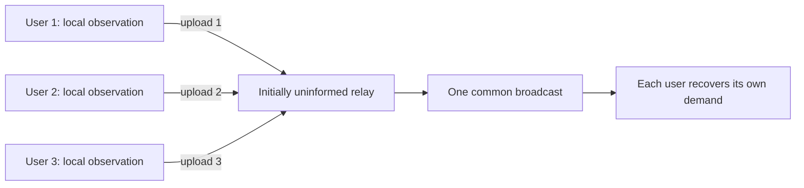

# The Upload–Broadcast Cost Region of Three-User Linear Computation

**Exact Finite-Field Algorithms and Lean Formalization**

[Algorithm code](algorithm/) · [Lean proofs](lean/) · [Reproduction](docs/REPRODUCING.md)

Research code and formal proofs accompanying *The Upload–Broadcast Cost Region of Three-User Linear Computation* by Shuo Tan and Syed A. Jafar. The Python package constructs upload encoders, a relay broadcast encoder, and user decoders. The Lean development formalizes the optimal cost region and the minimum linear blocklength. The manuscript is maintained separately.

## The problem

For a source $x\in\mathbb F_q^n$, user $i\in\{1,2,3\}$ observes $A_i x$ and requests $W_i x$. The matrices are prescribed and known when the code is designed. A task is feasible precisely when every demand lies in the users' joint observation span:

$$
\operatorname{row}(W_i)\subseteq\sum_{j=1}^3\operatorname{row}(A_j),\qquad i=1,2,3.
$$

Each user sends one noninteractive upload computed solely from its own observation. An initially uninformed relay receives the three uploads individually over noiseless links, then sends one common broadcast. Each user decodes from that broadcast and its own observation, with zero error for every source realization.



The two resources are **total upload across the three users** and **common broadcast**. Costs are logarithms to base $q$ of attainable message-alphabet sizes, normalized by the number $L$ of computation instances. For linear messages, total upload is the sum of the three upload-matrix ranks divided by $L$; broadcast cost is the source-to-broadcast matrix rank divided by $L$. See the [model and cost definitions](docs/TECHNICAL_OVERVIEW.md#model-and-costs).

## Optimal region and blocklength

Let $U^*$ be the minimum total upload when broadcast cost is unconstrained, and let $D^*$ be the minimum broadcast cost when the server knows the entire source. Let $\mathcal R_L$ contain the pairs of **cost budgets** that a length-$L$ code can meet; a code need only use costs at most those budgets.

**Proven in the accompanying research:** for every feasible task over every finite field,

$$
\mathcal R_2=\overline{\bigcup_{L\ge1}\mathcal R_L}
=[U^*,\infty)\times[D^*,\infty).
$$

Thus one code attains both minima simultaneously, and **two instances already suffice for the entire budget region**. The converse covers deterministic, possibly nonlinear, fixed-length zero-error codes of arbitrary blocklength.

The optimal corner has a linear realization over the **original field**, including $\mathbb F_2$. Its minimum **linear** blocklength is

$$
L_{\min}^{\mathrm{lin}}=
\begin{cases}
1,& U^*,D^*\in\mathbb Z,\\
2,& \text{otherwise}.
\end{cases}
$$

Here scalar means one computation instance, not one transmitted symbol. The integrality criterion concerns linear codes; a separate binary example shows that two instances can also be necessary for nonlinear codes.

Joint design is essential: an arbitrary upload-optimal relay observation can require more than $D^*$ broadcast cost. The construction selects among upload-optimal observations while preserving the broadcast bound. For decomposed tasks, it combines corresponding entries of the 15-entry LCBC broadcast profiles before taking their maximum; independently optimizing component broadcast costs can lose this benefit. See the [technical overview](docs/TECHNICAL_OVERVIEW.md#why-the-construction-is-joint).

## Two complementary components

| Component | What it provides | Entry point |
| --- | --- | --- |
| [Python algorithm](algorithm/) | Exact target costs; executable upload, broadcast and decoder matrices; matrix certificates of decoding for every source block | [Algorithm guide](algorithm/README.md) |
| [Lean formalization](lean/) | Proofs of the budget region, simultaneous optimal-code existence, and minimum linear blocklength over the original finite field | [Lean guide](lean/README.md) |

The compiler first attempts explicit constructions for recognized task structures, then falls back to exhaustive finite-field subspace search. By default it uses the minimum linear blocklength above. Search can take exponential time; the default limits are 100,000 visited search states and a 60-second cooperative time budget. `SearchBudgetExceeded` reports resource exhaustion and makes no infeasibility claim.

The implementation supports prime-power field orders $2\le q<2^{64}$, including extension fields represented in a polynomial basis. Its exact matrix certificates establish local encodability and zero-error decoding and check costs against the implemented analytical formulas. Lean checks the corresponding mathematical declarations. **No refinement theorem connects the Python implementation to the Lean formalization.**

## Run an example

Python 3.12 is recommended; the algorithm supports Python 3.10 or newer and has no third-party runtime dependencies.

```sh
git clone https://github.com/TSEason2022/The-Upload-Broadcast-Cost-Region-of-Three-User-Linear-Computation.git
cd The-Upload-Broadcast-Cost-Region-of-Three-User-Linear-Computation/algorithm
python3.12 -m venv .venv
. .venv/bin/activate
python -m pip install .
python -m three_user_codes demo --q 2 --n 1 --output code.json
python -m three_user_codes verify code.json
python -m three_user_codes simulate code.json
```

This binary example uses two source instances, eight upload symbols and three broadcast symbols: normalized costs U = 4 and D = 3/2. See the [manual](algorithm/docs/ALGORITHM_MANUAL.md) for the model, input format, construction and execution details.

## Recorded verification

**Computed — algorithm recheck, 15 November 2026:** all **256 regression tests**, **171 benchmark trials** (57 frozen tasks repeated three times), eight command/API checks, and an isolated package-installation check passed. The benchmark covers GF(2), GF(3), GF(4), GF(5) and GF(9), with source dimensions 3–30. A separate arithmetic implementation checked each returned code on every original source basis vector. Commands, seeds, limits and source digests are in the [algorithm recheck](algorithm/validation/CURRENT_RECHECK.md).

**Certified — recorded Lean 4.19.0 source snapshot:** all **314 library modules** compiled and both full-library axiom audits passed. The coverage map links **28 named manuscript results** to **103 distinct theorem declarations**, each checked for its type and transitive axiom dependencies. The run reused pinned upstream dependency objects, began without compiled project modules, and confirmed that the formal inputs remained unchanged. The audits permit only `propext`, `Classical.choice`, and `Quot.sound`.

The main Lean statements are in [SourceMainTheorem.lean](lean/UploadBroadcast/SourceMainTheorem.lean). The [verification report](lean/docs/PUBLIC_RECHECK.md), [coverage mapping](lean/coverage.json), and [manuscript correspondence record](lean/current-source-coverage.json) distinguish compiled declarations from review of their correspondence with informal statements. Historical reports identify their own source snapshots.

See [reproduction instructions](docs/REPRODUCING.md) and the [technical overview](docs/TECHNICAL_OVERVIEW.md).

## Attribution and rights

The research authors are Shuo Tan and Syed A. Jafar. Existing attribution and dependency notices are preserved. No new software license is granted by this repository preparation; consult [rights information](RIGHTS.md), [algorithm licensing](algorithm/LICENSING.md), and [Lean rights](lean/RIGHTS.md).
