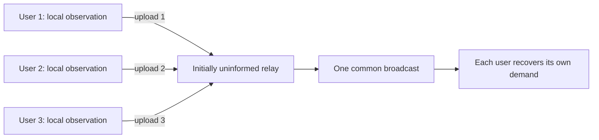

# The Upload–Broadcast Cost Region of Three-User Linear Computation

**Exact Finite-Field Algorithms and Lean Formalization**

[Algorithm code](algorithm/) · [Lean proofs](lean/) · [Reproduction](docs/REPRODUCING.md)

This repository accompanies the research *The Upload–Broadcast Cost Region of Three-User Linear Computation* by Shuo Tan and Syed A. Jafar. It provides executable code constructions, exact code certificates, and a separate Lean development. The manuscript is maintained separately.

## The problem

Three users observe different linear measurements of the same finite-field source. Each user wants another linear function of that source. The users upload separately to a relay, which initially knows none of the source. The relay sends one common broadcast, and every user recovers its demand using that broadcast and its own observation.



The design question is whether minimizing total upload prevents the relay from attaining the broadcast cost of a fully informed server.

## Main result and construction

**Proven in the accompanying research:** for every feasible three-user linear task, the closed upload–broadcast cost region is rectangular: the minimum total upload and fully informed minimum broadcast can be attained simultaneously. The region statement allows nonlinear, fixed-length, zero-error codes of arbitrary blocklength.

The optimal corner has a linear realization over the task's original finite field, including GF(2). Its minimum linear blocklength is **one when both optimal normalized costs are integers, and two otherwise**. These statements concern this three-user model and its stated feasibility assumptions.

The construction first finds the freedom in upload-optimal schemes, coordinates choices across components through their linear computation broadcast profiles, and repairs directed demand cycles when needed. An arbitrary upload-optimal choice need not preserve the broadcast optimum.

## Two complementary components

| Component | What it provides | Entry point |
| --- | --- | --- |
| [Python algorithm](algorithm/) | Finite-field task analysis; local upload encoders, a relay encoder and three decoders; exact all-source code certificates | [Algorithm guide](algorithm/README.md) |
| [Lean formalization](lean/) | Formal mathematical declarations, pinned dependencies, source checks and axiom audits | [Lean guide](lean/README.md) |

The Python compiler uses structural constructions and exact search. Unrestricted fallback search can take exponential time; a search-budget stop means resource exhaustion. It is not an infeasibility certificate.

The Python implementation and the Lean development are separate artifacts. A checked Python code certificate verifies that concrete construction. A Lean kernel check verifies formal declarations under their hypotheses. No formal refinement proof connecting the Python executable to the Lean development is claimed.

## Run an example

Python 3.12 is recommended; the algorithm supports Python 3.10 or newer and has no third-party runtime dependencies.

```sh
git clone https://github.com/TSEason2022/The-Upload-Broadcast-Cost-Region-of-Three-User-Linear-Computation.git
cd The-Upload-Broadcast-Cost-Region-of-Three-User-Linear-Computation/algorithm
python3.12 -m venv .venv
. .venv/bin/activate
python -m pip install .
python -m three_user_codes demo --q 2 --n 1 --output code.json
python -m three_user_codes verify code.json
python -m three_user_codes simulate code.json
```

This binary example uses two source instances, eight upload symbols and three broadcast symbols: normalized costs U = 4 and D = 3/2. See the [manual](algorithm/docs/ALGORITHM_MANUAL.md) for the model, input format, construction and execution details.

## Evidence and reproducibility

**Computed, with exact finite-field arithmetic:** the current algorithm recheck passed all **256 regression tests**, **171 benchmark trials** (57 frozen tasks repeated three times), eight command/API checks, and an isolated package-installation check. The benchmark covers GF(2), GF(3), GF(4), GF(5) and GF(9), with source dimensions 3–30. Commands, seeds, budgets, statuses and source digests are recorded in the [algorithm recheck](algorithm/validation/CURRENT_RECHECK.md).

**Certified for the recorded Lean source snapshot:** all **314 library modules** compiled, both comprehensive axiom audits passed, and all **103 mapped theorem targets** passed the current-source type and axiom checks. The run began without project compiled artifacts and confirmed that its formal inputs remained unchanged.

For Lean, consult the [current verification report](lean/docs/PUBLIC_RECHECK.md), [coverage mapping](lean/coverage.json), [current manuscript alignment](lean/current-source-coverage.json), and pinned [toolchain](lean/lean-toolchain). Reports identify their source snapshot and distinguish kernel checking, axiom checking, and correspondence with manuscript statements. Historical reports retain their original version scope.

See [reproduction instructions](docs/REPRODUCING.md) and the [technical overview](docs/TECHNICAL_OVERVIEW.md).

## Attribution and rights

The research authors are Shuo Tan and Syed A. Jafar. Existing attribution and dependency notices are preserved. No new software license is granted by this repository preparation; consult [rights information](RIGHTS.md), [algorithm licensing](algorithm/LICENSING.md), and [Lean rights](lean/RIGHTS.md).
