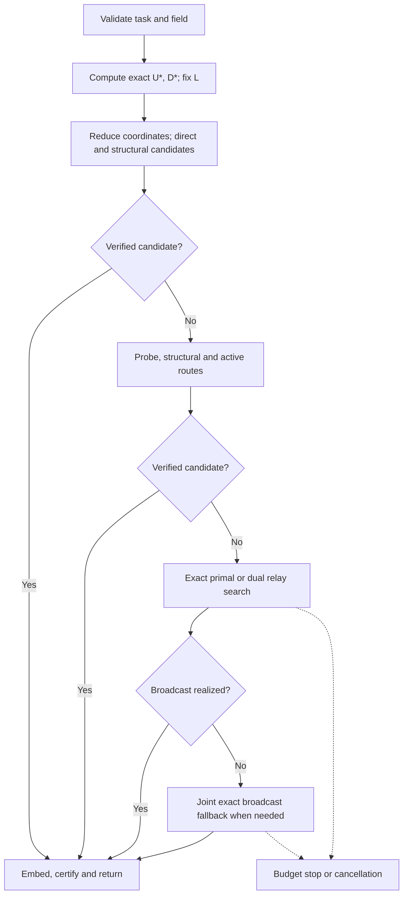
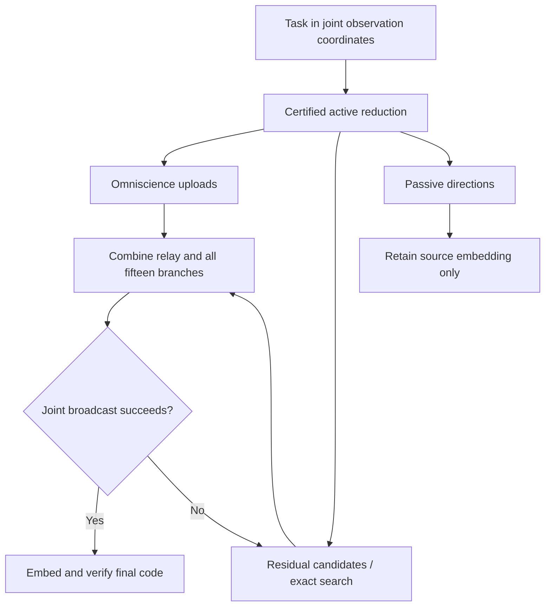
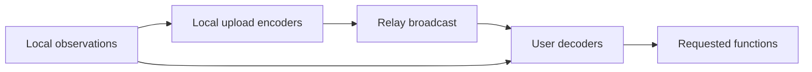

# three-user-codes 1.5.0 — Algorithm and Engineering Manual

This readable and editable Markdown export accompanies ALGORITHM_MANUAL.pdf. For synchronized regeneration, edit tools/build_manual.py (the authoritative authoring source), then run python tools/build_manual.py after installing the docs extra. Direct edits to this export are overwritten by regeneration. Editable vector artwork is in diagrams/pipeline.svg, diagrams/active.svg and diagrams/execution.svg; Mermaid sources appear below.

## 1. Engineering handover

three-user-codes 1.5.0 | Algorithm and integration manual

This package compiles a three-user finite-field observation/demand task into local upload encoders, a relay broadcast encoder, and three zero-error decoders. Every returned code is verified by exact matrix identities for all possible source values.

> Core contract: use the original input field. Select L = 1 when both exact optimal rates are integers; otherwise select L = 2. A resource stop never silently changes that blocklength.

### Read the package in this order

| Reader / task | Start here |
| --- | --- |
| Recipient running a first task | Pages 2, 9 and 10; README.md |
| Algorithm reviewer | Pages 3–8; editable ALGORITHM_MANUAL.md |
| Service / application integrator | Pages 10–12; docs/API.md; SECURITY.md |
| Researcher refining the implementation | Pages 6–8 and 12–14; tests/; validation/ |

### Delivery contents

The source project contains the runtime package, current regression tests, minimal examples, the API reference, this manual, and current validation evidence. Historical releases and old benchmark reports are intentionally excluded. The PDF is intended for review and onboarding. tools/build_manual.py is the editable authoring source; it regenerates the Markdown export and vector artwork together.

### What is and is not certified

Feasibility is checked by exact local-generation and decoding identities. Equality to the target costs is checked against separately recomputed rank formulas. The global optimality and minimum-blocklength interpretation depend on the supplied manuscript theorem, rather than a formal proof assistant.

### Document map

| Pages | Subject |
| --- | --- |
| 2–3 | Model, notation, exact rates and blocklength |
| 4–6 | Compiler flow and structural construction |
| 7–8 | Exact search, broadcast realization and certificates |
| 9–11 | CLI, Python execution and integration contracts |
| 12–14 | Engineering design, validation and refinement |

All matrices, code examples and public interfaces use a row-function convention: source samples are columns. Do not transpose an input merely because another coding library uses a column-generator convention.

## 2. Model and finite-field representation

Inputs, coordinate order and symbols

Let x be an n-dimensional column over F_q. User i observes A_i x and requests W_i x. Define the augmented space V_i = row(A_i) + row(W_i). In this manual V_i denotes the augmented space to avoid confusing it with the scalar upload rate U*. The source is arbitrary; the guarantee is zero-error linear recovery.

| Symbol | Meaning |
| --- | --- |
| q | Prime-power field order; q = p^m |
| A_i, W_i | Observation and requested-function matrices, for i = 1,2,3 |
| V_i | Augmented rowspace A_i + W_i |
| L | Number of source instances in one coding block |
| E_i = T_i A_i | Upload matrix and local observation encoder |
| E; P | Stacked uploads; their rowspace |
| B | Relay encoder acting on stacked uploads |
| C_i, H_i | Broadcast and side-information decoder matrices |
| U*, D* | Optimal symbols per original source instance |

### Original rows are an operational contract

Task canonicalizes rowspaces for algebra but retains original_side and original_demand. Redundant observation rows and their order survive execution. The runtime adapter maps the certificate back to the exact input measurement and output convention. All six input matrices must share the field and source width. A demand outside the joint observation span is rejected.

### Extension fields are polynomial fields

Field(q, modulus=None) requires a prime power q < 2**64. Elements are Python integers in [0,q), excluding bool. For q = p^m an integer encodes base-p polynomial coefficients; multiplication is reduced by an irreducible modulus. GF(4) is not arithmetic modulo 4. A supplied modulus must be monic and irreducible. Preserve the serialized field representation across services.

### Block and sample layout

For L instances, source coordinates are instance-major: x^(0), x^(1), …, x^(L-1). Observation and demand rows follow the same instance order. A runtime Matrix column represents one complete L-instance block. Multiple columns are independent blocks processed in a single call. Empty matrices require an explicit ncols to retain their width.

> Use exact integers and the Field API. Floating-point rank tolerances, ordinary modular arithmetic for extension fields, and unchecked fixed-width integer accumulation do not preserve these semantics.

## 3. Exact costs and blocklength

The mathematical target precedes construction

### Broadcast profile

For spaces X and A define r(X | A) = dim(X + A) − dim(A). Put m_i = dim(V_i) − dim(A_i), M = m_1 + m_2 + m_3, V_ij = V_i ∩ V_j, and V_123 = V_1 ∩ V_2 ∩ V_3. Let t_i = r(V_i ∩ (V_j + V_k) | A_i), where {i,j,k} = {1,2,3}.

```text
F_ijk = M - r(V_ij | A_j) - t_k
Q_i,l = [2M - r(V_123 | A_l)
         - r(V_ij + V_ik | A_i) - t_j - t_k] / 2
D* = max(all six F_ijk, all nine Q_i,l)
```

The six F branches follow permutations 123, 132, 213, 231, 312, 321. The nine Q branches follow (i,l) in row-major order. broadcast_profile returns the exact Fraction cost and all fifteen branches. Branches add under direct sums; their maximum generally does not.

### Upload formula

```text
omega = max(c + tau_1, c + tau_2, c + tau_3,
            (3c + tau_1 + tau_2 + tau_3) / 2)
U* = rho + r0 + b + omega
```

upload_parameters computes these integers from a simultaneous three-side-space normal form: rho measures required private projections; c is the common pure-tripod demand dimension; r0 is the remaining pure-tripod demand dimension; b is the graph-relation rank modulo pure-tripod demands; tau_i measures demand in the other two users’ common observation space modulo the common three-user space. upload_bound.py is the executable definition, including graph-lift conventions.

### Minimum original-field blocklength

```text
L_min = 1  if U* and D* are both integers
        2  otherwise
upload_count = L * U*; broadcast_count = L * D*
```

This contract follows the supplied manuscript, Theorem 1, equation (18), including the binary field. The default and fast_paths=False both use L_min. Explicit force_blocklength=2 returns exactly two original-field instances. Forcing 1 when a rate is half-integral raises BlocklengthError.

> A theorem bounding L does not bound search time. Integral rates remove fractional symbol counts; they do not guarantee that the current structural recognizer finds a scalar code cheaply.

## 4. Compiler control flow

A verified result or an explicit operational stop



Candidates require local generation, the target profile and actual broadcast realization. Dispatch uses direct constructors, targeted structural recognition and lazy scalar candidates, with a bounded 32-state scalar probe and active reduction before full search. Recognition failure continues at the same L. Binary realization can require the joint exact pass.

All routes share the compile budget and cancellation token. Time checks are cooperative, including algebra checkpoints. No-success after a complete unbudgeted search at the theorem-guaranteed length is ConstructionError: an implementation/theorem consistency issue, not a nonexistence certificate.

> Strategy labels and counters are diagnostic. Integrations should branch on result success or exception type, not on an exact private route name.

## 5. Active reduction and joint construction

Remove irrelevant work while retaining exact embeddings



The side normal form separates common, pairwise, private and tripod coordinates. Active reduction extracts an omniscience component, an active residual and passive directions, with exact coefficient embeddings back to the source task.

```text
component_row_in_source = component_row @ embedding
embedding.shape = (component_dimension, source_dimension)
```

active_reduce(task).verify(task) checks the side/augmented reconstruction and component roles. This is a decomposition check, not yet a final operating-code certificate. Omniscience uploads can be fixed while residual relays are searched.

### Why broadcast construction remains joint

Optimizing each component’s maximum broadcast branch separately can overpay. The compiler evaluates the sum of all fifteen branch profiles and realizes one broadcast for the combined relay. At L=2, small scalar menus are a warm start; the complete lifted search retains arbitrary cross-instance mixing.

> Direct-sum decomposition is an optimization opportunity, not a license to add separately minimized broadcast costs. Keep the branch vectors and source embeddings until joint acceptance.

## 6. Structured multi-component construction

Supported composition and its exact acceptance boundary

### Goal of the structural route

A collection of recognizable resonant R_n components and private-demand edges should be handled through verified source-space embeddings, local relay menus, and a joint broadcast. Dense source-basis changes must not alter the algebraic acceptance criteria.

### Implementation status

The structural_compiler.py route automatically discovers repeated or mixed R_n summands, extracted private-demand edges/cycles and a zero-excess remainder after active reduction. No generator labels are supplied. It solves a restricted endomorphism system, probes fixed-seed operators, and certifies stable image/kernel splits with complementary idempotent projectors preserving all six flags. Recognized embeddings feed six-slack integer allocation and multiplicity-based cycle repair. For L=2 it decomposes once and duplicates component multiplicities, permitting cross-instance pairing. The resulting relay must pass the existing joint broadcast and certificate gates. Recognition is bounded: at most 512 local probes, source dimension 80 and 384 variables for endomorphism and reference-isomorphism systems; unsuccessful or unsupported tasks retain the complete fallback. This is not a full classification or all binary Table V constructions.

### Capacity reasoning used during candidate selection

A resonant component can offer several relay choices. Their effects must be combined at the level of the full fifteen-entry profile. The six F branches carry orientation-sensitive capacity; the nine Q branches remain constraints that must be checked, even where a family theorem says they are invariant. A private-demand cycle may require a mixed upload across a component boundary.

A candidate that passes a profile test is still subject to actual finite-field broadcast construction. Over GF(2), equal branch vectors do not generally imply equal scalar realizability. A deduplication or pruning rule therefore requires its own proof and field-specific preconditions.

### Refinement rules

| Change | Required evidence |
| --- | --- |
| New component recognizer | Exact embeddings; reconstruction of all six flags; dense-basis tests |
| New relay menu | Local generation, upload count/rank and complete branch profile |
| Cycle assignment | Exact repaired upload rows and an actual joint broadcast |
| Multiplicity shortcut | Equivalence to explicit small compositions over several fields |
| Binary special case | Actual scalar realization and the required separation conditions |

The final certificate is the common acceptance gate. An unsupported or unsuccessful structural path falls through to exact search at the selected blocklength. The package does not claim a complete polynomial-time quiver decomposition algorithm.

## 7. Exact primal and dual fallback

Complete search with sound finite-field pruning

### Primal: allocate local upload dimensions

The primal engine allocates upload counts to users and enumerates local quotient extensions in canonical reduced-row-echelon form. It rejects a partial relay when the remaining users cannot satisfy necessary demand or rank cuts. Canonical relay rowspaces support compile-local memoization; cache limits affect reuse, not mathematical coverage.

### All-subset capacity checks

```text
For every nonempty subset S of remaining users:
dim(P + sum(C_i for i in S)) - dim(P)
    >= sum(remaining_quota_i for i in S)
```

There are at most seven subsets. A failed condition prunes the branch. Tight demand cuts restrict allowed local spaces. When a multi-user capacity group is tight, the implementation constructs a quota-respecting independent basis with Hall lookahead and collapses the forced combined span. This preserves every final relay rowspace while avoiding internal enumeration.

### Dual: enumerate a relay annihilator

The dual engine represents a relay by the kernel of a normal matrix and visits canonical prefixes. A prefix must preserve the equality of images of A_i and V_i, a necessary condition for demand recovery modulo the relay.

```text
K_i = A_i intersect ker(N_prefix)
J_i = V_i intersect ker(N_prefix)
For a new normal column v, require for every i:
    K_i v is nonzero  OR  J_i v is zero
```

The incremental implementation updates these residual kernel spaces by one-pivot elimination instead of rebuilding every prefix nullspace. The completed relay still passes local-generation, profile and broadcast checks. The dispatcher estimates primal and dual enumeration sizes; this is a search-order heuristic, not a complexity guarantee.

### Completeness and binary fallback

A sufficient binary LCBC construction can fail for a particular relay even when another broadcast works. When needed, the joint exact pass enumerates target-dimensional broadcast spaces as well as relay choices. Only exhaustive failures may be used as exhaustive rejection evidence; a failed fast constructor alone is insufficient.

> Worst-case enumeration remains exponential. max_states counts visited search work, including prefixes; it is not a version-independent performance unit. SearchBudgetExceeded is a resource result, never infeasibility.

## 8. Broadcast construction and certificate

Recover the requested functions for every source

### Induced broadcast problem

For a candidate relay P, choose a canonical relay basis E. Restrict each observation and augmented space to P, then express these intersections in relay coordinates. The broadcast problem operates on this induced task. The resulting broadcast is mapped back to the actual order of local upload rows.

The constructive LCBC route allocates common, pairwise, aligned and private broadcast groups. Decoder coordination works in the smaller quotient V_i/A_i. Its quotient map is constructed directly from side-space pivots, avoiding a full ambient annihilator. Empty demand quotients skip factorization.

### The binary distinction

For q >= 3 the manuscript provides a general three-user scalar LCBC construction at the integer ceiling. For GF(2), the separated-side spanning construction has additional hypotheses. build_lcbc(..., round_up=True) can realize a ceiling cost for the standalone problem; compile_task never rounds its final optimal upload/broadcast targets.

### All-source verification identities

```text
E_i = T_i A_i                          (local uploads)
W_i = C_i B E + H_i A_i               (zero-error decode)
sum rows(E_i) = rank(E) = L * U*
rows(B) = rank(B E) = L * D*
```

Here A_i and W_i refer to the lifted, canonical task used by the certificate. The operating adapter restores original row order and redundant rows. Since each equality is an exact matrix identity, it holds for every source column, not just the samples used in simulation.

### Result binding

CompileResult stores exact Fraction optima, the certificate, a task representation fingerprint, and diagnostic statistics. result.verify(task) checks the binding, recomputes the costs and verifies the identities. Loading a saved code repeats verification rather than trusting a stored “verified” label.

> A feasibility certificate and an optimality theorem have different roles. The certificate proves the supplied encoder/decoder equations. The implemented formulas and the mathematical theorem justify the target optimum.

## 9. Installation and command-line workflow

Run from the directory containing pyproject.toml

### Quick start

```text
python -m pip install .
python -m three_user_codes --version
python -m three_user_codes demo --q 2 --n 1 \
  --output code.json --task-output task.json
python -m three_user_codes verify code.json
python -m three_user_codes simulate code.json
```

Requires Python 3.10 or newer. The runtime uses only the standard library. In demo, --n is the resonant chain length; the source dimension is 3n + 2. The binary n=1 task has U*=4, D*=3/2 and therefore L=2, with 8 upload and 3 broadcast symbols.

### Inspect and compile your task

```text
python -m three_user_codes inspect task.json
python -m three_user_codes compile task.json \
  --max-states 100000 --max-seconds 60 \
  --progress --output code.json
```

inspect computes rates and minimum blocklength without synthesis. --blocklength 1 or 2 requests a specific original-field length; omit it for the minimum. --no-fast-paths selects the complete search route. --unlimited removes search limits and can lead to very long runtimes.

### Minimal task JSON

```text
{"schema":"three-user-task-v1", "q":2, "n":3,
 "side":[[[1,0,0]], [[0,1,0]], [[0,0,1]]],
 "demand":[[[0,1,0]], [[0,0,1]], [[1,0,0]]]}
```

For custom extension-field representation use save_task to emit the full field object; do not provide both q and field. Exactly three side and three demand arrays are required. Empty row arrays are valid when n is explicit.

### Process status

| Exit | Meaning |
| --- | --- |
| 0 | Verified result / successful requested operation |
| 1 | Construction or internal algebra consistency error |
| 2 | Invalid input, invalid length or failed verification |
| 3 | Search budget exhausted; no infeasibility conclusion |
| 130 | Cancellation or keyboard interruption |

Successful machine-readable output is JSON on stdout. --progress emits JSON lines on stderr. --debug before the subcommand preserves internal consistency tracebacks.

## 10. Python integration and execution

Compile once; execute many source blocks

```text
from three_user_codes import (
    Field, Matrix, compile_task, resonant_task, save_code,
    load_code, SearchBudgetExceeded,
)

task = resonant_task(Field(2), 1)
try:
    result = compile_task(task, max_states=100_000,
                          max_seconds=60.0)
except SearchBudgetExceeded as exc:
    print(exc.stats)
    raise

result.verify(task)
save_code(result, task, "code.json")
result, task = load_code("code.json", allow_legacy=False)
code = result.operating_code(task)

# Only this simulation has full source access.
x = Matrix(task.field, [[i % 2]
           for i in range(result.certificate.task.n)])
observations = tuple(A @ x for A in code.original_side)
execution = code.execute(observations)
assert execution.decoded == tuple(
    W @ x for W in code.original_demand
)
```



In deployment, each user supplies only its own observation matrix. Use encode_uploads(observations), broadcast(uploads), and decode_all(observations, signal) to separate the protocol stages. code.execute performs the same sequence conveniently. iter_execute consumes observation batches lazily; the caller chooses batch size.

> Do not send full source x to encoders in a production protocol. It appears above only to generate observations and check a reproducible simulation.

## 11. Integration contracts and resources

Stable interfaces and explicit trust boundaries

### Compile API

```text
compile_task(task, *, max_states=100_000,
    max_seconds=60.0, fast_paths=True,
    force_blocklength=None, max_cache_entries=2048,
    cancel_event=None, progress=None,
    progress_interval=0.25)
```

cancel_event must provide is_set(), as threading.Event does. progress receives immutable ProgressEvent(stage, search_states, elapsed_seconds). Callbacks are synchronous, contribute to elapsed time and may propagate exceptions. Nested compile calls restore the surrounding context.

### Strict JSON and fingerprints

The loader rejects duplicate keys, explicit nonfinite values and invalid field/shape data. Default ReadLimits are 32 MiB input, four million coefficient cells, 100,000 rows, 100,000 columns and a maximum imported blocklength of 4,096. The input task and certificate share the matrix allocation budget. These controls are not CPU or resident-memory limits.

New writers produce three-user-compiled-code-v2. Its SHA-256 fingerprint binds the field representation, source width and original side/demand rows in order. JSON formatting is irrelevant. A hash stored beside data is not authentication: pin a separately trusted expected_fingerprint when provenance requires it. Saves use atomic replacement.

### Task versus certificate compatibility

load_code(path, allow_legacy=False) enforces the current result wrapper. The default loader also supports older verified certificates for import compatibility; no old release is included in this delivery. Imported blocklength allowance does not change the L<=2 contract for new compilation.

### Service deployment

Keep state/time limits for unfamiliar tasks. max_seconds is cooperative and cannot interrupt a blocked callback or preempt every arithmetic operation. Put compilation in a supervised process when a hard deadline or memory limit is required. Cache entry and coefficient-cell limits bound cache growth, not total process RSS.

Arithmetic, pivoting and search are data dependent. This is exact coding software, not a constant-time cryptographic primitive. The runtime needs no network, shell execution, eval or pickle. Public constructors remain the input-validation boundary; private trusted matrix constructors are not public API.

> Use exception classes and verification results as your integration contract. Statistics, internal module names and route labels are diagnostic and may evolve.

## 12. Engineering architecture

Where the optimization lives and where to extend it

| Layer / module | Responsibility and invariant |
| --- | --- |
| field.py; linalg.py | Exact field arithmetic, immutable matrices, canonical rowspaces |
| task.py; upload_bound.py; profile.py | Input semantics and exact upload/broadcast formulas |
| structure.py; mixing.py; structural_compiler.py; active_reduction.py | Verified structural candidates and source embeddings |
| compiler.py; active_relay.py | Route dispatch, exact primal/dual search and joint acceptance |
| lcbc.py; coordination.py | Original-field broadcast construction in demand quotients |
| certificate.py; provenance.py | All-source identities, counts/ranks and task binding |
| io.py; runtime.py; cli.py | Strict interchange, executable protocol and public tooling |

### Implemented efficiency principles

Scalar candidates are generated lazily and tested immediately; L=2 streams combinations while retaining complete fallback. Coordinate solves reuse immutable-matrix pivot factorizations, and shared-basis right-hand sides are batched. Normal forms, upload parameters and verified active reductions reuse immutable Task-local results. Internal proven-valid slices avoid repeated element validation while public constructors remain strict. Tight Hall-capacity groups collapse to a quota-respecting basis; dual prefix kernels update by one-pivot elimination. Certificate construction performs one complete pre-return verification. These are implemented changes; release evidence, rather than call-count reductions alone, determines measured performance.

### Safe extension procedure

Add a constructor that returns an actual relay or local uploads in a documented coordinate system. Verify local generation and target count before invoking joint broadcast acceptance. Retain the complete fallback. Keep budget checks inside expensive loops and let cancellation propagate. Preserve the original-field blocklength and task fingerprint contracts.

### Changes that need a separate project

A native finite-field backend, persistent packed-matrix storage, resumable search checkpoints and a universal indecomposable decomposition engine are not implied by the present package. Each needs an explicit compatibility contract and measurements. GF(2) already uses bitwise integer elimination; describing this as a new backend would be inaccurate.

When adding a backend, match extension-field basis and modulus exactly. Differentially compare ranks, solves, kernels and emitted certificates against the reference arithmetic. Fixed-width multiply-accumulate overflow must be prevented before modular reduction.

> Optimize time to a verified code, peak memory and budget completion coverage. Reducing an internal call count alone is not an end-to-end performance claim.

## 13. Validation and repeatable refinement

Evidence belongs to the delivered source revision

### Release validation

The delivered revision passed all 256 regression tests. A 57-scenario suite run three times completed 171/171 trials under 3-second and 100,000-state per-compilation budgets, with native certificate checks and independent source-basis decoding checks. These results measure the supplied task families, not a universal runtime guarantee. See validation/RELEASE_VALIDATION.md and its machine-readable evidence for the source hash, environment, timings and exact cases. The commands below reproduce the core suite.

```text
python -m unittest discover -s tests -v
python -m compileall -q three_user_codes
python -m three_user_codes demo --q 2 --n 1 \
  --output /tmp/three_user_code.json
python -m three_user_codes verify /tmp/three_user_code.json
```

### What each test layer establishes

| Layer | Purpose |
| --- | --- |
| Exact algebra | Field laws, shape/empty cases, rowspaces, kernels and solves |
| Small independent oracles | Compare selected rates and search results with separate small enumerations |
| Structural families | Recognized components, demand-cycle repair and dense basis changes |
| Compiler contracts | Minimum L, forced L, budgets, cancellation and fallback |
| Certificates / I/O | Tamper rejection, original-row binding, strict JSON and atomic save |
| Runtime execution | Local-only encoders, sample columns, redundant rows and output order |

### Adding a reproducible regression

Save the smallest task JSON that reproduces the problem, including field modulus. Record source version, Python version, budget, fast-path setting, returned strategy, rates, L, verification result and elapsed time. Reduce dimensions only while preserving the failure. For basis invariance, apply an invertible source transform and verify the transformed result independently.

### Performance comparison rules

Use the same tasks, seeds, budgets and machine. Report successes, budget stops and errors separately. Repeat timings and report medians or quantiles; compare speed only on paired successful tasks. Include preprocessing, broadcast construction and verification. Record peak memory for large inputs. Synthetic family coverage does not estimate performance on all possible tasks.

> Do not turn a budget stop into a negative mathematical example. Do not report known-decomposition timings as automatic-discovery performance. Keep feasibility checks and optimum checks visible in the evidence.

## 14. Handover limits and maintenance guide

A precise boundary makes the next iteration reviewable

### Known limits

Generic exact search remains exponential in the worst case. Structural routes cover specified families and may miss a useful decomposition or cycle assignment. The current package is not a proof of fixed-parameter tractability or a universal polynomial-time synthesizer. Large prime-power fields may require expensive field setup and arithmetic.

Binary scalar broadcast requires special care: an integral LCBC profile alone is not a general scalar realizability theorem for arbitrary standalone binary broadcast inputs. The end-to-end task compiler retains actual realization checks and complete fallback at the chosen length.

### Troubleshooting

| Observation | Action |
| --- | --- |
| Budget exhausted | Keep the task and stats; inspect rates; increase a justified budget or improve its structural route |
| Forced L=1 rejected | Inspect exact denominators; use default policy or request L=2 |
| Certificate binding fails | Use the original task rows/order and field representation; investigate tampering |
| Extension-field mismatch | Compare modulus and polynomial-basis encoding, not just q |
| Unexpected source/observation shape | Use L*n source rows and instance-major observation order |
| ConstructionError | Preserve input and traceback; treat as a defect needing diagnosis |

### Refinement priorities

First improve structural coverage on verified multi-component cases. Then measure candidate generation, coordinate factorization and broadcast work before changing linear-algebra storage or adding native dependencies. Preserve inexpensive complete-search exits for small tasks. Every new pruning rule needs a soundness argument and adversarial small-case comparison.

### Theoretical correspondence

The theoretical reference is Shuo Tan and Syed A. Jafar, “The Upload–Broadcast Cost Region of Three-User Linear Computation”, supplied manuscript. Publication status and date are not asserted. The implementation uses Theorem 1, equation (18); the upload rank formula; fifteen broadcast branches; and Appendix D demand-cycle and broadcast constructions. The manuscript PDF is not duplicated.

### Ownership and public distribution

The algorithm code and its accompanying software documentation are available under the MIT License, copyright (c) 2026 Shuo Tan. See LICENSE and LICENSING.md. This license does not apply to research papers, the sibling Lean formalization, or other repository materials; their existing rights and licenses are unchanged. Existing attribution is preserved. No third-party runtime dependency is introduced.

> The manual authoring source, API reference, current tests and validation evidence form the maintenance handover. A new change is ready when its contract is stated, its acceptance invariant is checked and its evidence can be reproduced.
